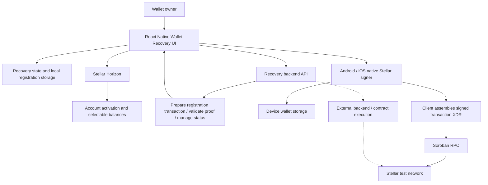
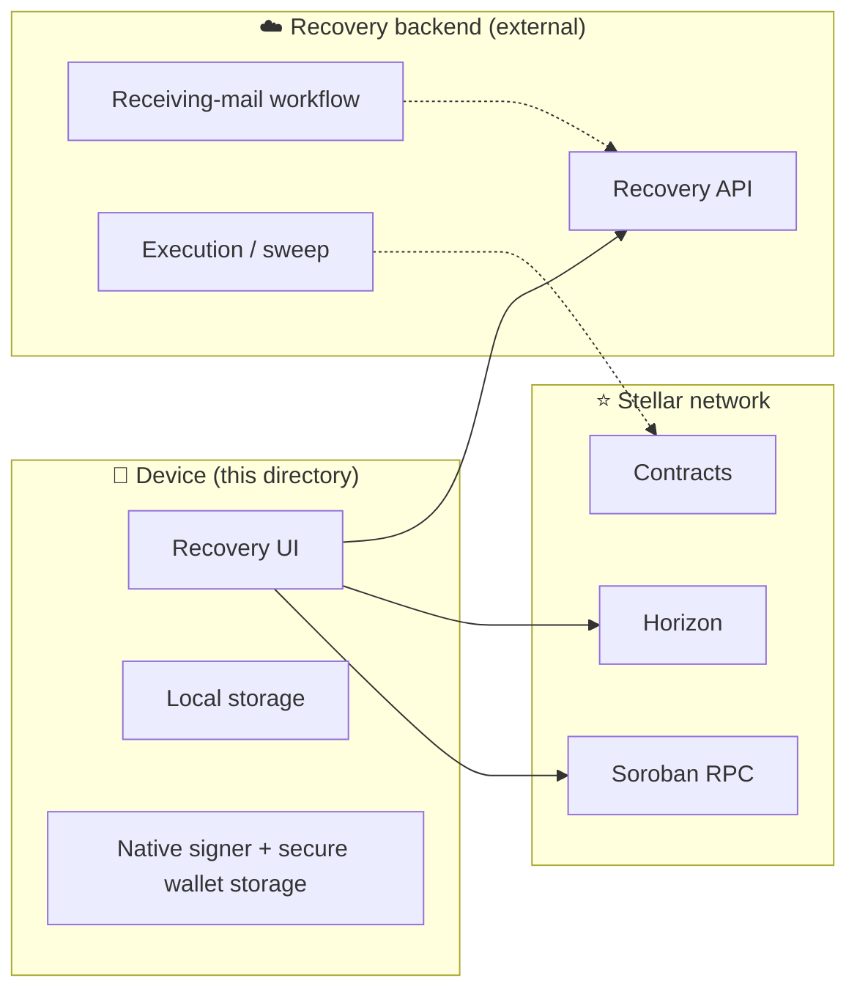
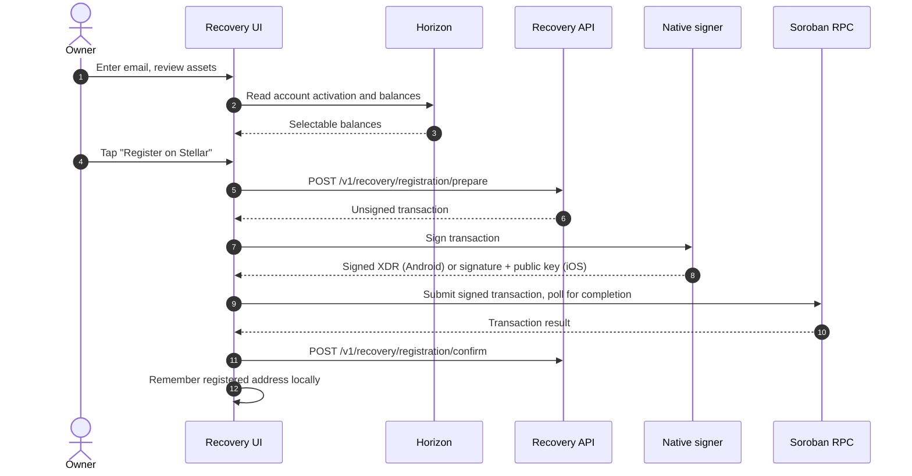
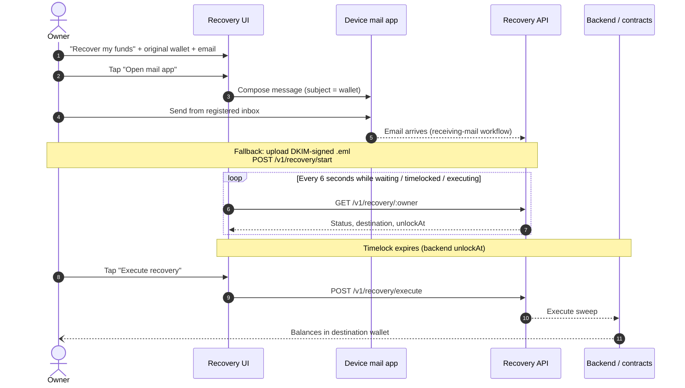
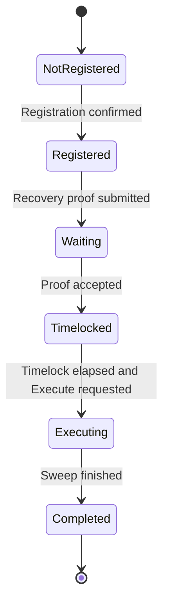

# 🏗️ Recovery Module: Mobile Client & Integration Architecture

This document outlines the architecture of the **Wallet Recovery** feature within the SwiftEx React Native app, detailing how the client integrates with the native Stellar signer, the recovery backend API, Stellar Horizon, and Soroban RPC.

> [!NOTE]
> Solid lines in diagrams show client integrations **present in source**. Dashed lines show **expected external behavior** (backend and contracts) that has **not been verified** here.

---

## 📌 Table of Contents
1. [Overview & Responsibilities](#-overview--responsibilities)
2. [Client Architecture](#-client-architecture)
3. [Trust Boundaries](#-trust-boundaries)
4. [Flows & Status Lifecycle](#-flows--status-lifecycle)
5. [Integration Points](#-integration-points)
   - [1. Wallet Layer (Native Signer)](#1-wallet-layer-native-signer)
   - [2. Recovery Backend API](#2-recovery-backend-api)
   - [3. Stellar Horizon & Soroban RPC](#3-stellar-horizon--soroban-rpc)
   - [4. Mail, Files & Local Storage](#4-mail-files--local-storage)
6. [Native Signing](#-native-signing)
7. [Supported Stellar Assets & Reserve Floor](#-supported-stellar-assets--reserve-floor)
8. [On-Chain Contract Reference](#-on-chain-contract-reference)
9. [Deployment Verification Checklist](#-deployment-verification-checklist)
10. [Known Limitations](#-known-limitations)
11. [Glossary](#-glossary)

---

## 🎯 Overview & Responsibilities

The Wallet Recovery feature serves as the user-facing interface for email-guardian account recovery:

* **Separation of Concerns:** Proof verification, timelock enforcement, and asset movement belong to the external backend and its deployed contracts. Those implementations are not included in this directory.
* **Client Responsibility:** The app reads account data, guides the user through guardian registration, signs the registration transaction on the device, coordinates the recovery flow with the backend, and shows live recovery status.

| Principle | How it shows up |
| :--- | :--- |
| **Keys stay on device** | The device signs locally; the Stellar secret is not sent to the recovery API. |
| **Thin client, backend authority** | Verification, timelock, and sweep are backend and contract concerns. |
| **Email as the guardian** | Intent is proven from the registered inbox, or via a DKIM-signed `.eml` fallback. |
| **Safety delay** | The timelock length comes from the backend (`unlockAt`). |
| **Selective protection** | Native XLM is always included; classic issued assets are optional. |

---

## 🧩 Client Architecture



**User-facing flows**

```
+-------------------------------------------------------------------------------+
|                             Wallet Recovery screen                            |
|                  (Set up recovery  |  Recover my funds)                       |
+-------------------------------------------------------------------------------+
           |                                                      |
           v                                                      v
+---------------------------+                       +----------------------------+
|   Set up recovery         |                       |   Recover my funds         |
|   (Registration)          |                       |   (Emergency claim)        |
+---------------------------+                       +----------------------------+
 |-- 1. Enter + confirm email                        |-- 1. Original wallet + email
 |-- 2. Review / select assets                       |-- 2. Open mail app / .eml fallback
 |-- 3. Backend prepares unsigned tx                 |-- 3. Timelock countdown (polling)
 |-- 4. Device signs, app submits                    |-- 4. Execute recovery
           v                                                      v
+-------------------------------------------------------------------------------+
|        State, Storage & Services (Redux wallet state + local storage)          |
|  - Recovery API adapter (HTTP client for the recovery backend)                |
|  - Horizon / Soroban RPC access (balances, submit, poll)                      |
|  - Async storage (registered wallet addresses)                                |
|  - Native signer bridge (Android / iOS)                                       |
+-------------------------------------------------------------------------------+
```

---

## 🔒 Trust Boundaries



| Zone | Responsible for | Verified in this directory? |
| :--- | :--- | :---: |
| **Device** | UI, local state, local signing | ✅ Source present |
| **Backend** | Preparing transactions, validating proof, tracking status, triggering execution | ❌ Not included |
| **Stellar network** | Account data, transaction submission, contract state | ❌ Deployed contracts not verified |

---

## 🔄 Flows & Status Lifecycle

### Registration



### Recovery



### Status lifecycle

The screen polls while recovery is **waiting**, **timelocked**, or **executing**. The diagram is conceptual; exact status names and transitions are defined by the backend.



---

## 🔌 Integration Points

### 1. Wallet Layer (Native Signer)
* Uses the device-held Stellar key through the native signer on each platform.
* Signs the registration transaction on the device. The secret is never sent to the recovery API.
* See [Native Signing](#-native-signing) for the iOS and Android differences.

### 2. Recovery Backend API
* **Base URL:** provided by the parent application's deployment (this directory defines no environment variables of its own).
* **Endpoints expected by the client** (client expectations, not a verified server specification):

| API path | Purpose | Used in |
| :--- | :--- | :--- |
| `POST /v1/recovery/registration/prepare` | Prepare an unsigned Stellar registration transaction | Registration |
| `POST /v1/recovery/registration/confirm` | Confirm registration after the signed transaction is submitted | Registration |
| `POST /v1/recovery/registration` | Additional registration helper | *Not used by the current screen's prepare/sign/confirm flow* |
| `POST /v1/recovery/start` | Submit a signed `.eml` recovery proof (manual fallback) | Recovery |
| `GET /v1/recovery/:owner` | Retrieve recovery state, destination, and timelock info | Recovery (polling) |
| `POST /v1/recovery/execute` | Request execution after the timelock has elapsed | Recovery |
| `POST /v1/recovery/cancel/prepare` | Prepare a cancellation transaction | *Adapter only, no screen action* |
| `POST /v1/recovery/cancel/confirm` | Confirm cancellation after signing | *Adapter only, no screen action* |

### 3. Stellar Horizon & Soroban RPC
* **Horizon:** Used to read account activation and USDC trustline data for both the original and destination wallets. The destination must always be activated; its configured USDC trustline is required only when the original wallet has that same trustline.
* **Soroban RPC:** Used to submit the locally signed registration transaction and poll for completion.
* Both are configured by the parent app deployment.

### 4. Mail, Files & Local Storage

| Integration | Role |
| :--- | :--- |
| Device mail app | Composes the recovery email (**Open mail app**) |
| Document picker | Selects a DKIM-signed `.eml` proof file |
| Async storage | Remembers registered wallet addresses |

| Client behavior | Detail |
| :--- | :--- |
| **Polling** | Every **six seconds** while waiting, timelocked, or executing |
| **Foreground refresh** | Status refreshes when the app returns to the foreground |
| **Local storage caveat** | Remembered addresses are **not** proof of on-chain registration |
| **Cancellation** | Helpers exist in the adapter, but the screen exposes no cancel action |

---

## ✍️ Native Signing

| | 🍎 iOS | 🤖 Android |
| :--- | :--- | :--- |
| **Key source** | Stellar secret from the device **Keychain** | Active wallet from **`SecureWalletStore`** |
| **Native output** | A signature and public key | Signed transaction XDR |
| **JS client role** | Adds the signature and public key to the transaction | Uses the returned XDR |
| **Network passphrase** | Stellar testnet | Stellar testnet |
| **Secret sent to API?** | No | No |

---

## 💰 Supported Stellar Assets & Reserve Floor

1. **Native Stellar Lumens (XLM):**
   * **Always protected:** automatically selected and cannot be deselected.
   * **Reserve floor:** the client sends a `floor` of `20000000` stroops. Backend enforcement and the account's actual reserve requirements must be verified separately.
2. **Classic Stellar assets:**
   * Only **USDC** issued by `GBBD47IF6LWK7P7MDEVSCWR7DPUWV3NY3DTQEVFL4NAT4AQH3ZLLFLA5` is supported.
   * It is selected by default and users can deselect it before registration.

---

## 📜 On-Chain Contract Reference

This client module does **not** define or expose contract IDs. They must be taken from the deployed recovery service and must not be guessed.

| Contract | Network | Address |
| :--- | :--- | :--- |
| **Recovery contract** | Stellar Testnet | *Obtain from the deployed recovery service* |
| **Native XLM SAC** | Stellar Testnet | *Obtain from the deployed recovery service* |
| **Other asset SACs** | Stellar Testnet | *Obtain from the deployed recovery service* |

---

## ✅ Deployment Verification Checklist

Items this directory cannot confirm and that should be verified against the real deployment:

- [ ] Recovery contract ID(s) documented from the deployed service
- [ ] Asset issuer allowlist (if any) documented
- [ ] Backend enforces the XLM `floor` (`20000000`) and real reserve requirements
- [ ] Timelock length and `unlockAt` behavior
- [ ] Receiving-mail workflow and DKIM validation
- [ ] Destination-wallet selection procedure and ownership checks
- [ ] Network configuration (native signers currently use the testnet passphrase)
- [ ] An end-to-end sweep on a test wallet

---

## ⚠️ Known Limitations

* Proof verification, timelock enforcement, and asset movement happen in the external backend/contracts.
* The screen validates the user-entered destination wallet against Horizon, but destination ownership verification remains an external deployment responsibility.
* The mail action uses the wallet passed to the screen, even if the original-wallet field was edited.
* No cancellation action is exposed on the screen.
* Tests use mocks and do not validate a real on-chain sweep.

---

## 📖 Glossary

| Term | Meaning |
| :--- | :--- |
| **Guardian** | The registered email address used to prove recovery intent |
| **Timelock** | Safety delay between proof and execution; ends at the backend's `unlockAt` |
| **Sweep** | Moving the protected balances to the destination wallet |
| **XDR** | Stellar's serialized transaction format |
| **DKIM** | Email signature standard that lets a message's origin be verified |
| **`.eml`** | A saved email message file, used as the manual proof fallback |
| **Horizon** | Stellar's HTTP API for account and ledger data |
| **Soroban RPC** | Stellar's smart-contract RPC service, used here to submit and poll transactions |
