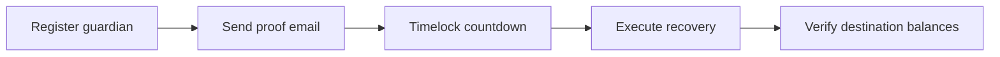

# 🚀 SwiftEx Wallet Recovery: End-to-End Walkthrough & Verification Guide

This guide provides instructions for running, testing, and verifying the **email-guardian recovery lifecycle** in the SwiftEx mobile app on the Stellar test network.

> [!TIP]
> Use **test assets and a test wallet**. Never use a wallet or email account that contains production funds.

---

## ⚡ Quick Start & Local Serving

Run these from the repository root of the complete SwiftEx app:

```bash
# 1. Install dependencies
npm install

# 2. iOS only: install CocoaPods dependencies
bundle install
cd ios && bundle exec pod install && cd ..

# 3. Start Metro (terminal 1)
npm start

# 4. Launch the app (terminal 2)
npm run android      # or: npm run ios
```

Then connect or import a Stellar wallet and open **Wallet Recovery** from the wallet area.

---

## 🛠️ Step 1: Wallet Setup & Pre-Demo Checks

1. Prepare a **test** Stellar wallet that is **activated** (funded with test XLM for the reserve and fees).
2. Connect or import it in the app.
3. Confirm the deployment owner has configured Horizon, Soroban RPC, the recovery backend, and native signing.
4. Ask the backend operator for the **destination-selection procedure**. The screen has no destination input.
5. Make sure you have access to the inbox you will register as the guardian.

### Demo checklist

- [ ] Test wallet is activated and holds a little test XLM
- [ ] Recovery backend is reachable from the device
- [ ] Destination-selection procedure obtained from the backend operator
- [ ] Receiving-mail workflow configured (or a DKIM-signed `.eml` ready)
- [ ] Backend `unlockAt` timelock known, so you can plan demo time

---

## 🧪 Step 2: Protocol Verification Walkthrough

### Scenario A: Registering a Guardian (Protecting Your Wallet)

1. **Open Recovery:** Go to **Wallet Recovery** from the wallet area.
2. **Set Up Recovery:** Choose **Set up recovery**.
3. **Enter Email:** Enter the recovery email address and confirm it.
4. **Choose Assets:**
   - Review the assets loaded from the wallet.
   - **Native XLM is required** and cannot be deselected.
   - Optionally select supported classic Stellar assets to protect.
5. **Register on Stellar:** Tap **Register on Stellar**.
   - *Under the hood:* the backend prepares an unsigned transaction, the **device signs it locally**, and the app submits it to Stellar. The secret is never sent to the recovery API.
6. **Confirmation:** The app confirms registration with the backend and remembers the wallet address locally.

> [!NOTE]
> The locally remembered address is a convenience, **not** proof of on-chain registration.

---

### Scenario B: Simulating Emergency Recovery (Lost Key Access)

1. **Go to Recover Funds:** Return to **Wallet Recovery** and choose **Recover my funds**.
2. **Specify Details:** Enter the **original Stellar wallet** and the **registered email**.
3. **Send the Proof Email:**
   - Tap **Open mail app** and send from the registered inbox.
   - The **subject must match the original wallet being recovered**. The mail action uses the wallet passed to the screen, even if the original-wallet field was edited.
   - The backend's receiving-mail workflow must be configured.
4. **Fallback: Manual `.eml` Proof:**
   - If the receiving-mail workflow is unavailable, select a **delivered, DKIM-signed `.eml`** file and submit it.
   - A copy from the **Sent** folder may lack the signature and be rejected.
5. **Track Progress:** The app refreshes recovery status automatically, **every six seconds**, while waiting, timelocked, or executing, and when the app returns to the foreground.
6. **Timelock Countdown:** The countdown uses the backend's `unlockAt` value. This client does not define a fixed recovery delay.
7. **Execute Recovery:** When the timelock expires, tap **Execute recovery**.
8. **Verify:** Check that the swept balances appear in the destination wallet.



---

## 🔍 Verification

| What to verify | How |
| :--- | :--- |
| Registration reached Stellar | Look up the original wallet's transaction history on a Stellar **testnet** block explorer |
| Proof accepted | Recovery status moves from waiting to timelocked in the app |
| Timelock behavior | Countdown matches the backend's `unlockAt` |
| Sweep result | Destination wallet balances increase by the protected amounts |
| Contract details | Take recovery contract and asset SAC IDs from the deployed recovery service; this client does not define them |

---

## 🎯 Architecture Highlights

* **Device-Held Signing:** Transactions are signed locally with the device-held Stellar key.
* **No Secret to the API:** The Stellar secret is not sent to the recovery backend.
* **Selective Protection:** Native XLM is always protected; classic assets are optional.
* **Safety Timelock:** A backend-controlled delay separates proof from execution.
* **Manual Proof Fallback:** A DKIM-signed `.eml` can be submitted if the mail workflow is unavailable.

> [!WARNING]
> This guide does not claim a successful native build or a verified live recovery. Proof verification, timelock enforcement, and asset movement depend on the external backend and its deployed contracts.